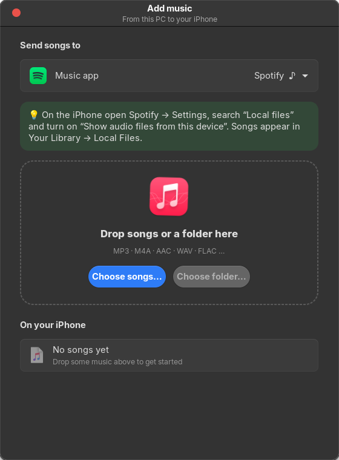

# iPhone Tools

A small **3uTools-style iPhone manager for Linux**, built with GTK4 + libadwaita on top of [libimobiledevice](https://libimobiledevice.org/).




## Features

- **Device overview** – name, model, iOS version and capacity, detected automatically when you plug the phone in
- **Battery** – charge level, **battery health %** (max vs design capacity in mAh), charge cycles and temperature
- **Storage** – used / free, calculated like *Settings → General → iPhone Storage*, with an iOS / Photos / Apps breakdown
- **Add music** – drag & drop songs or a folder (MP3, M4A, AAC, WAV, FLAC…) and send them to a music app on the iPhone (Spotify *Local Files*, VLC, …), see and remove the songs already there
- **Quick actions** – open photos and app files, full **backup** with progress, rename the iPhone, copy all info, restart or shut down the phone
- **Animations** – animated ring gauges and counters, growing storage bar, slide-in sections, hover effects
- **Screen mirroring** – see the iPhone screen live inside the app (AirPlay over Wi‑Fi, via UxPlay) in an iPhone-shaped frame, with sound, auto-rotation, fullscreen and screenshots
- **Connection repair** – detects when the iPhone is plugged in but Linux's iPhone service (usbmuxd) stopped responding, and fixes it with one click (asks for your password)

## Requirements

- Linux with GNOME (tested on Ubuntu 24.04, GNOME 46)
- Python 3 with PyGObject, GTK 4.14+ and libadwaita 1.5+ (preinstalled on Ubuntu 24.04)
- libimobiledevice tools:

```bash
sudo apt install libimobiledevice-utils usbmuxd ifuse
```

- For screen mirroring (optional):

```bash
sudo apt install uxplay gstreamer1.0-plugins-bad
```

## Install

```bash
git clone https://github.com/Mortadha994/iphone-tools.git
cd iphone-tools
./install.sh
```

Then open **iPhone Tools** from the apps menu. Plug in your iPhone, unlock it and tap **Trust**.

## Notes

- Screenshots of the phone are not supported: iOS 17+ blocks the screenshot service for libimobiledevice 1.3.
- Songs can't be added to the built-in **Apple Music** app from Linux (that needs Apple's ATC sync service, which has no open-source implementation). Instead they go into a music app that accepts files from a computer. For Spotify, turn on *Settings → Local files → Show audio files from this device* on the iPhone.
- Backups are saved unencrypted to `~/iPhone Backups`.
