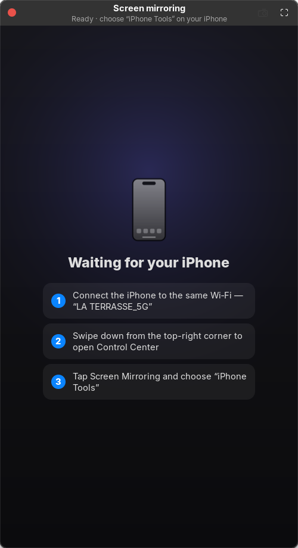

# iPhone Tools

A **3uTools-style iPhone manager for Linux**, built with GTK4 + libadwaita on top of
[libimobiledevice](https://libimobiledevice.org/), [pymobiledevice3](https://github.com/doronz88/pymobiledevice3)
and [UxPlay](https://github.com/FDH2/UxPlay).


| Add music | Screen mirroring |
|---|---|
|  |  |

## Features

- **Device overview**: name, model, iOS version and capacity, detected automatically when you plug the phone in
- **Battery**: charge level, **battery health %** (max vs design capacity in mAh), charge cycles and temperature
- **Storage**: used / free, calculated like *Settings → General → iPhone Storage*, with an iOS / Photos / Apps breakdown
- **Add music**: drag & drop songs or a folder (MP3, M4A, AAC, WAV, FLAC…) into a music app on the iPhone (Spotify *Local Files*, VLC, …), and see or remove the songs already there
- **Screen mirroring**: the iPhone screen **live inside the app** (AirPlay over Wi‑Fi) in an iPhone-shaped frame, with sound, auto-rotation, fullscreen and **screenshots**
- **Backup**: full first backup, then **incremental** (only changes), with progress
- **Quick actions**: open photos and app files, rename the iPhone, copy all info, restart or shut down the phone
- **Connection repair**: detects when Linux's iPhone service (usbmuxd) got stuck and fixes it with one click
- **Animations**: ring gauges and counters, growing storage bar, slide-in sections, hover effects

## Quick start (Ubuntu 24.04 or newer)

```bash
# 1. dependencies (everything, including the optional extras)
sudo apt install -y python3-gi gir1.2-gtk-4.0 gir1.2-adw-1 gir1.2-gstreamer-1.0 \
    libimobiledevice-utils usbmuxd ifuse uxplay gstreamer1.0-plugins-bad pipx
pipx install pymobiledevice3 && pipx ensurepath

# 2. the app
git clone https://github.com/Mortadha994/iphone-tools.git
cd iphone-tools
./install.sh
```

Open **iPhone Tools** from the apps menu, plug in your iPhone, unlock it and tap **Trust**.

`install.sh` checks every dependency first. If something required is missing, it prints the exact
`sudo apt install …` line to run. Optional extras are only suggested:

| Feature | Needs |
|---|---|
| The app (info, battery, storage, music, files, rename, restart) | `python3-gi gir1.2-gtk-4.0 gir1.2-adw-1 gir1.2-gstreamer-1.0 libimobiledevice-utils usbmuxd ifuse` |
| Screen mirroring | `uxplay gstreamer1.0-plugins-bad` |
| Backups on iOS 17 and newer | `pymobiledevice3` (via `pipx`) |

Requires GTK 4.14+ and libadwaita 1.5+ (Ubuntu 24.04 / GNOME 46 or newer).

## Update / uninstall

```bash
cd iphone-tools
git pull && ./install.sh     # update
./install.sh --uninstall     # remove (backups and screenshots are kept)
```

## Using it

- **Screen mirroring**: click **Mirror screen**. On the iPhone, open **Control Center → Screen Mirroring → “iPhone Tools”**. The iPhone and the PC must be on the same Wi‑Fi. If “iPhone Tools” isn't listed yet, wait 5–10 s.
- **Add music**: songs can't go into the built-in **Apple Music** app from Linux (that needs Apple's private ATC sync service). They go into a music app that accepts files, such as **Spotify**: on the iPhone, open *Spotify → Settings → Local files* and turn on **Show audio files from this device**. They then appear in *Your Library → Local Files*.
- **Backups** are saved **unencrypted** to `~/iPhone Backups`. Keep them private.

## Troubleshooting

| Problem | Fix |
|---|---|
| “Connection problem” / the phone isn't detected | Click **Repair connection** in the app (or run `sudo systemctl restart usbmuxd`), unlock the iPhone and replug it |
| “Unlock your iPhone” | Unlock it and tap **Trust**. Unlock the iPhone *before* plugging it in |
| Mirroring plays sound but no picture | Update the app (`git pull && ./install.sh`). Receiver messages are in `~/.cache/iphone-tools/uxplay.log` |
| “Another mirroring receiver is running” | Close the other UxPlay window or run `pkill uxplay` |
| Backup stays at 0 % | Install pymobiledevice3 (see above). libimobiledevice 1.3's backup hangs on iOS 26 |

## How it works

One Python file (`iphone_tools.py`) with the GTK4 UI. Device data comes from the `idevice*` command-line tools,
music and files from `ifuse`, backups from `pymobiledevice3`. Mirroring runs `uxplay` as an AirPlay receiver
that hands decoded frames to the app over a private `127.0.0.1` socket.
